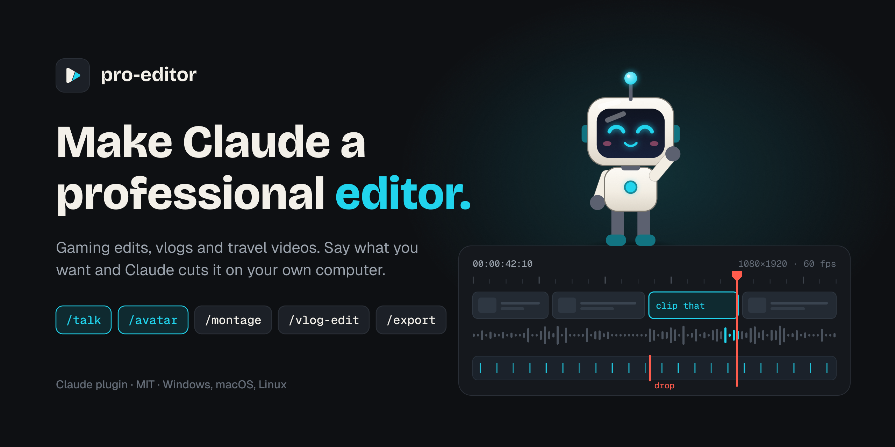
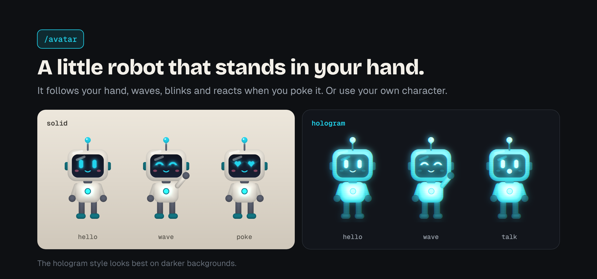
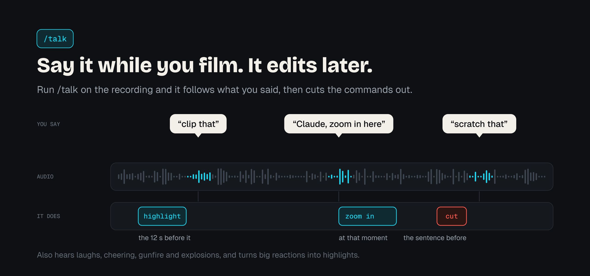
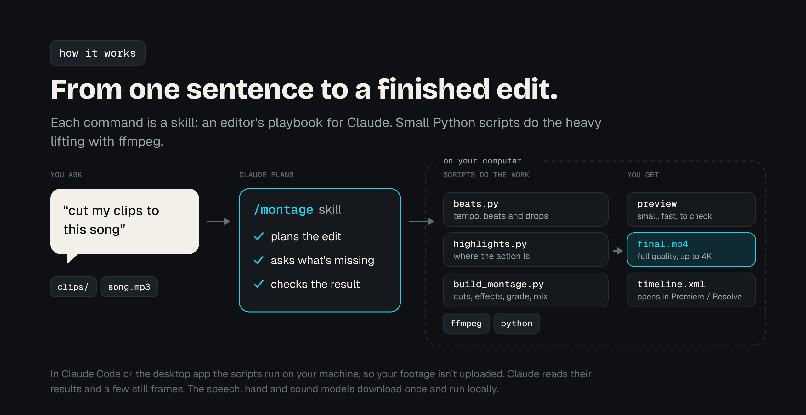

[](https://github.com/abdullahnaji353-blip/pro-editor/actions/workflows/ci.yml)
[](LICENSE)

pro-editor is a Claude plugin for editing gaming clips, vlogs, and travel or event videos, from
10-second TikToks to 45-minute YouTube videos. You describe the edit the way you'd describe it to a
person ("cut my clips to this song", "remove the ums and add captions") and Claude does it with
ffmpeg and Python on your own computer, showing you a quick preview before the final render.

## What it does

- Gaming: finds your best moments and cuts them to the beat, landing the action on the hit, with
  speed ramps, zoom punches, whip and spin transitions, shake, flashes, glitch and slow-mo. Cold
  opens, loop endings, HUD insets for vertical video.
- Talking videos: cleans up your voice, removes silences and "um"s, lets you edit by deleting lines
  of the transcript, adds word-by-word captions and YouTube chapters.
- Travel and events: picks the best-looking shots, grades them, cuts a recap to your song.
- `/talk`: listens to your recording and follows what you said while filming ("clip that",
  "Claude, zoom in here", "cut that", "let me redo that"). It also hears laughs, cheering and
  game sounds.
- `/avatar`: an animated character that stands in your palm and follows your hand, reacts when
  you poke it, and can appear from a closed fist. Solid or hologram style, or your own character.
- `/reference`: finds real examples of the edit you have in mind and works out how they're made.
- `/shorts`: turns a long stream, podcast or talking video into ranked vertical clips with captions,
  cut on whole sentences and framed on your face.
- `/create`: makes any video from scratch, drawn with code, in a real design language (editorial,
  news, hype, minimal, tech, pop) or an art style (pixel, chalkboard, glow sketch, comic, flat
  vector, line art, or 3D: PS2, Lego, CGI, toon): hype intros and kinetic typography
  synced to your song, promos, lyric videos, memes, explainers with a researched script. AI
  voiceover (ElevenLabs, or free Kokoro on your computer), an animated presenter that lip-syncs to it,
  AI or real clips inside scenes, music and captions.
- Sound effects that land: finds the moments that need one (cuts, cards and text popping in),
  picks from your sounds, free Openverse sounds or built-in ones, and hits each on its frame.
- Checks its own work before showing you: loudness, clicks at cuts, black or frozen frames, with
  frame strips around every cut. Lasting notes become rules it follows on every future edit.
- Exports for TikTok, Reels, Shorts and YouTube up to 4K, plus timelines for Premiere Pro and
  DaVinci Resolve and colour grades as `.cube` LUTs.



> Early version (0.16). Every tool is tested on generated test videos, but not much on real
> footage yet, so expect rough edges, especially in highlight picking and face tracking.
> Bug reports are very welcome.

## Getting started

### 1. Install the plugin

Claude app (desktop or web, paid plans): open Customize in the sidebar, go to Plugins, choose
Add → Add marketplace → Add from a repository, enter `abdullahnaji353-blip/pro-editor`, then add
pro-editor from the Discover tab.

Claude Code:

```
/plugin marketplace add abdullahnaji353-blip/pro-editor
/plugin install pro-editor@pro-editor
```

### 2. Install ffmpeg and Python packages

You need ffmpeg and Python 3.9 or newer. The first time you use the plugin, Claude checks what's
missing, shows you the commands, and asks before installing anything. To do it yourself:

| | |
|---|---|
| Windows | `winget install --id Gyan.FFmpeg -e` (then reopen the terminal), `python -m pip install -r requirements.txt` |
| macOS | `brew install ffmpeg`, `python3 -m pip install -r requirements.txt` |
| Linux | `sudo apt install ffmpeg`, `python3 -m pip install -r requirements.txt` |

Optional extras are listed in [`requirements-optional.txt`](requirements-optional.txt): transcripts
(`faster-whisper`), face tracking and the avatar (`opencv-python-headless`, `pillow`), and hand
tracking and sound recognition (`mediapipe`). Install only the ones you need.

### 3. Ask for an edit

Point Claude at your clips (in Claude Code, the folder you started it in; in the Claude app, a
connected folder or attached files) and say what you want. A few examples:

```
/start
Make a 20-second TikTok from the clips in my "fortnite" folder, cut to song.mp3. Hype style.
Here's my vlog. Cut the silences and the ums, make it vertical, add word-by-word captions.
Find the best shots from my Japan trip and make a 30-second recap to this song.
/talk   (attach the recording where you said "clip that" after your best plays)
/avatar put a little robot hologram in my hand that waves at the camera
/reference cinematic day-in-my-life vlog: find examples and how they're made
```

### 4. Check your setup (optional)

```
python scripts/selftest.py
```

It generates small test videos, runs every tool on them, and prints PASS or FAIL with a fix for
each failure, plus how long 1080p and 4K renders take on your machine. `--models` also tests the
speech, hand-tracking and sound models.

The [manual](docs/MANUAL.md) covers every command, option and workflow.

## Commands

You don't need to remember these; describing what you want works too. In Claude Code they may show
up as `/pro-editor:start`, `/pro-editor:montage` and so on.

| Command | Example | What it does |
|---|---|---|
| `/start` | "help me edit this" | Checks your setup and footage, asks what you're making, runs the right tools in order |
| `/checkup` | "is my footage ok?" | Finds phone-footage problems (audio drift, washed-out HDR, clipping) and makes fixed copies |
| `/talk` | "do what I said in the video" | Hears words and sounds, follows spoken instructions, turns "clip that" into highlights, takes voice notes as instructions |
| `/avatar` | "put a robot in my hand" | Hand-tracked animated character: waves, blinks, reacts to pokes, speech bubbles, talks with a voice line |
| `/reference` | "find examples of this edit" | Web research for references, how each is made, what they share, then a plan |
| `/shorts` | "make shorts from my stream" | Finds and ranks self-contained moments, then reframes and captions the ones you pick |
| `/create` | "make a hype intro synced to this song" | Animates a video from scratch: intros, promos, lyric videos, memes, explainers; beat-synced, AI voice and a talking presenter if wanted |
| `/trends` | "what edit style is trending?" | Current edit styles and sounds, turned into a style recipe |
| `/style-match` | "edit it like these 3 videos" | Measures pace, beat sync, colour and effects in reference edits |
| `/highlights` | "find the best moments" | Action, reactions or scenic shots |
| `/describe-clip` | "find the 1v3 with the shotgun" | Finds a moment by description, or edits one clip the way you describe |
| `/montage` | "cut these clips to this song" | Beat-synced edit with effects, preview first, plus a Premiere/Resolve timeline |
| `/vlog-edit` | "cut the silences and ums" | Voice cleanup, transcript editing, jump cuts and punch-ins, vertical crop, captions, chapters |
| `/long-video` | "make a 20-minute YouTube video" | Montage and raw sections, transitions, music that ducks under your voice |
| `/color` | "make it look cinematic" | Exposure and colour correction plus a look, saved as a LUT |
| `/thumbnail` | "make a thumbnail" | Picks sharp frames and builds a 1280x720 thumbnail with big text |
| `/edit-review` | "review my edit" | Feedback on beat sync (exact timestamps), dead spots, hook and loudness |
| `/export` | "ready for TikTok and YouTube" | Platform sizes, captions and text, loudness, titles and hashtags |

## Talking to it while you film



Say these while recording, then run `/talk` on the video:

| Say | What happens |
|---|---|
| "clip that", "clip it", "that's a clip" | The 12 seconds before become a highlight |
| "Claude, zoom in here", "Claude, slow mo that", "Claude, put the drop here" | That edit, at that moment |
| "cut that", "scratch that" | The sentence before is removed |
| "let me redo that", "one more time" | Marked as a retake, so the flubbed take goes |

The commands themselves are cut from the final video. A half-second pause before and after each one
makes the cut cleaner.

## How it works

Each command is a skill: instructions that tell Claude how an editor would approach the job (what
to ask, what to check, when to show a preview). Skills call small Python scripts that do the work
with ffmpeg, and every script can also be run on its own.



Everything runs where Claude runs commands: on your computer in Claude Code or the desktop app with
a connected folder, or in a cloud session on files you attach. Your footage is never uploaded by the
plugin. When Claude needs to see the video, it looks at a few still frames. The speech, hand-tracking
and sound models download once and run locally.

## Good to know

- Previews are small and fast; the full-quality render happens once, at the end.
- Resolution: `--res 1080 | 1440 | 2160 | source`. TikTok and Reels stay at 1080p because they
  downscale anything bigger. A graphics-card encoder is used automatically when one works.
- A 45-minute 1080p render can take 30 to 90+ minutes on a typical CPU, and 4K several times that.
  The self-test tells you what to expect on your machine.
- Copyrighted songs can get muted or claimed when you upload.
- The avatar is an original 2D character. Your fingers can't wrap around it and it doesn't change
  perspective if you turn your hand far; the hologram style hides that best.
- Not supported yet: hand-drawn speed curves, optical-flow slow motion, 3D camera moves, masking,
  transition packs, or driving CapCut directly. Highlight picking finds loud, busy or good-looking
  moments rather than "good plays", so check its picks.

## Updating

Claude Code: `/plugin marketplace update pro-editor`, then `/reload-plugins`. In the Claude app,
manage it under Customize → Plugins. See the [changelog](CHANGELOG.md) for what changed.

## Development

```
python -m pip install -r requirements-dev.txt
ruff check scripts tests && pytest       # lint and unit tests
python scripts/selftest.py               # end-to-end run on generated clips
```

[CONTRIBUTING.md](CONTRIBUTING.md) explains how the skills and scripts fit together.

## Feedback

Found a bug or have an idea? [Open an issue](https://github.com/abdullahnaji353-blip/pro-editor/issues)
with what you asked Claude, what happened, and the output of `python scripts/check_setup.py`.

## Credits

Ideas borrowed, with thanks, from two MIT-licensed projects: the render self-check, cut-boundary
frame strips and critic pass from [video-use](https://github.com/browser-use/video-use) by Browser
Use, and rules learned from your notes and free Groq transcription from
[free247editor](https://github.com/riecodes/free247editor) by riecodes. The code here is our own.

## License

MIT. See [LICENSE](LICENSE).
